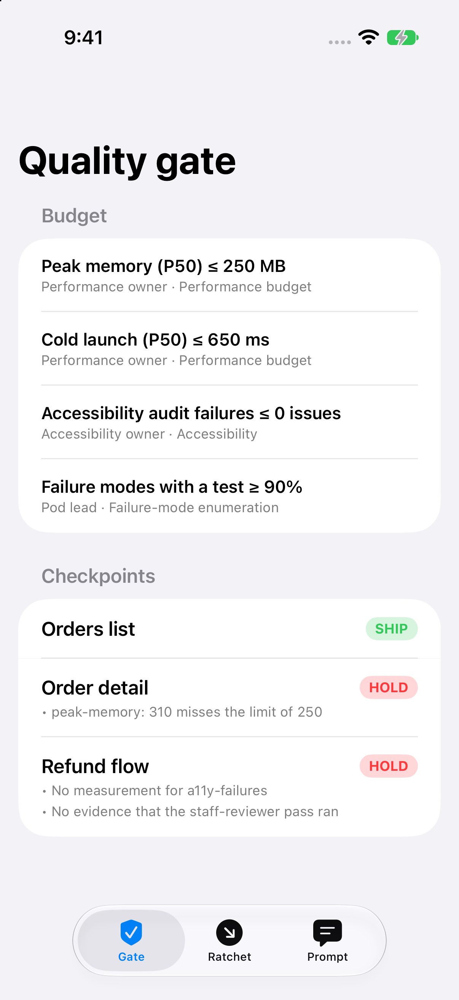
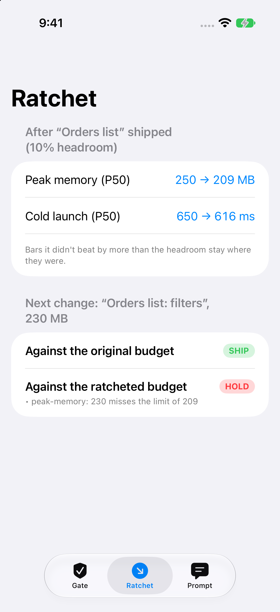

# QualityRatchet

A small Swift library and SwiftUI demo of a **quality budget** for teams whose coding agents have made them faster: measurable quality bars with named owners, quality passes that must leave evidence before a checkpoint ships, and a **ratchet** that tightens a bar when a checkpoint ships better than it, so the gain can't quietly leak back later beyond the headroom.

Article: (added after publish)

<p align="center">
  
  
</p>

## What it does

- **`QualityBar`**: a numeric limit (`atMost` or `atLeast`), a unit, a named owner, and the quality pass it belongs to. Empty owners and non-finite limits are rejected at construction.
- **`QualityBudget.evaluate(_:)`** returns `.ship` or `.hold([Finding])`. A checkpoint is held for a missing or non-finite measurement, a value outside its limit, a measurement id that matches no bar (usually a typo), or a required pass with no evidence (empty or whitespace-only notes count as missing).
- **`QualityBudget.ratcheted(by:headroom:)`** tightens each bar toward what a shipped checkpoint achieved, plus `headroom` (0 to 1). A limit only moves in the stricter direction. It throws if the checkpoint does not ship against the current budget, so a held checkpoint can never move a bar.
- **`PassPrompt.render(_:checkpoint:budget:)`** renders the instructions for one quality pass (failure modes, performance budget, accessibility, staff-reviewer pass) from the same budget the gate enforces, so a ratcheted limit shows up in the prompt too. Every prompt says: don't edit code during the pass, report only measured numbers with the tool that produced them, write "not measured" rather than estimating, and don't invent issues.

```swift
import QualityRatchet

let budget = try Samples.budget()
let before = budget.evaluate(Samples.ordersListFollowUp)   // .ship: 230 MB is under 250
let (ratcheted, changes) = try budget.ratcheted(by: Samples.ordersList, headroom: 0.10)
// changes: peak-memory 250 → 209, cold-launch 650 → 616
let after = ratcheted.evaluate(Samples.ordersListFollowUp)  // .hold: peak-memory 230 misses 209
```

The core of the ratchet:

```swift
let slack = abs(value) * headroom
let tightened: Double
switch bar.direction {
case .atMost: tightened = min(bar.limit, value + slack)
case .atLeast: tightened = max(bar.limit, value - slack)
}
```

The sample bars and checkpoints in `Samples.swift` are illustrative, per screen and made up. They are not anyone's production data; the 190 MB only echoes Shopify's app-wide iOS P50 peak-memory figure.

## How to run it

1. Clone the repo and open `Demo.xcodeproj`.
2. Pick an iPhone Simulator and press Build & Run. The library is a local package reference in the same repo, so there is no other setup.

The app has three tabs: **Gate**, **Ratchet** and **Prompt** (the performance-budget prompt rendered from the ratcheted budget).

Library only: `swift build` and `swift test` from the repo root. `Scripts/simulator-screenshots.sh` builds the app, launches each tab on a Simulator, checks the app is still running, and saves the screenshots in `Demo/Screenshots/`.

## Honest limits

- The gate checks numbers and evidence. It does not measure anything. Your own tooling (Instruments, XCTest metrics, an accessibility audit) has to produce the numbers.
- Evidence is a free-text note. The gate only checks that it is not empty, so a pod can write "done" and pass. Link to a trace, an audit or a PR comment that a reviewer can open.
- Ratcheting on a single noisy sample can lock in a lucky run. In a real pipeline, ratchet on a median of several runs.
- A `QualityBudget` is one set of bars. Keep one budget per screen or flow: ratchet a shared budget with your leanest screen and every other screen has to beat it. (The demo applies one sample budget to three screens only to show the gate's verdicts.)
- The library doesn't fail a build or save a ratcheted budget. Wiring `evaluate(_:)` into CI and committing the tightened limits back to the budget definition is your pipeline's job. This repo's CI runs the unit tests and the demo, not a quality gate on itself.
- There is deliberately no API to loosen a bar. In a real repo, loosening should be a reviewed edit to the budget definition, with a named approver.
- Headroom is relative to the measured value, so a checkpoint that measures 0 (like 0 accessibility failures) locks that bar at 0 with no slack, even if its limit was higher.

## Verification status

For the version in this repository:

- `rm -rf .build && swift build -Xswiftc -warnings-as-errors`: clean (Xcode 27.2, Swift 6.4.2).
- `swift test`: 28 Swift Testing tests in 4 suites (three are parameterized, covering 11 argument cases), 0 failures.
- The demo app was built with `xcodebuild` and run on a newly created iPhone 17 Pro Simulator (iOS 27.2). Each tab was launched, confirmed still running after 8 seconds, and screenshotted. The screenshots above are from that run.
- CI: (added after the first CI run)

## Sources

- Remi Vanhee, [How we rebuilt the Shopify app in 12 weeks](https://shopify.engineering/shopify-app-rebuild), Shopify Engineering, 10 Nov 2026.
- Fatbobman, [Fatbobman's Swift Weekly #162: Putting "Better" Before "Faster"](https://weekly.fatbobman.com/p/fatbobmans-swift-weekly-162), 16 Nov 2026.

## License

MIT. See [LICENSE](LICENSE).
